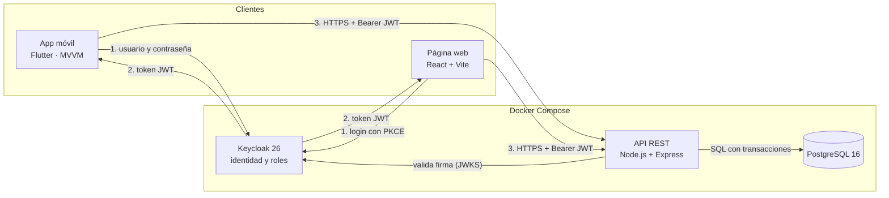
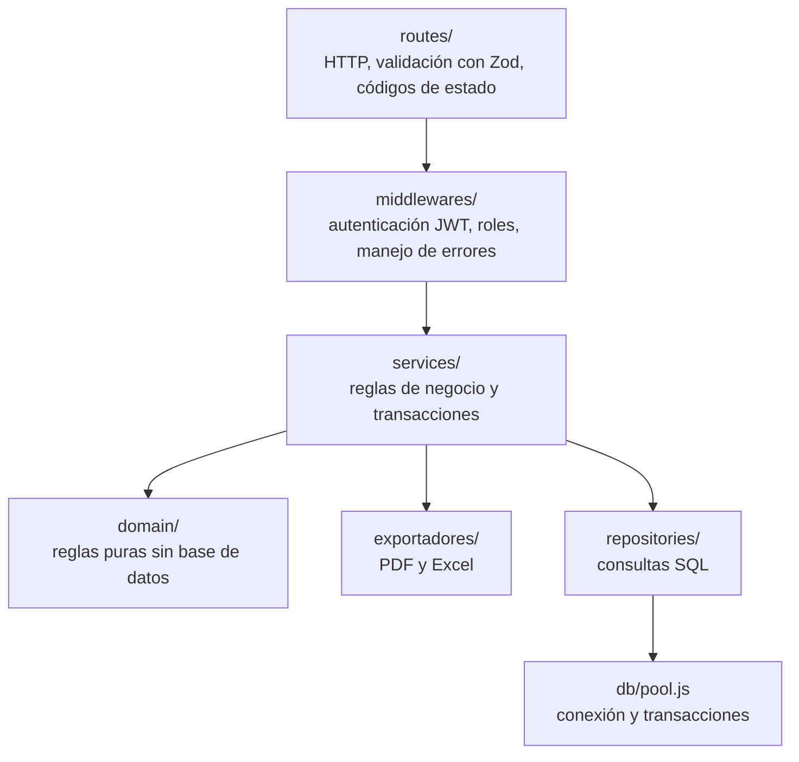
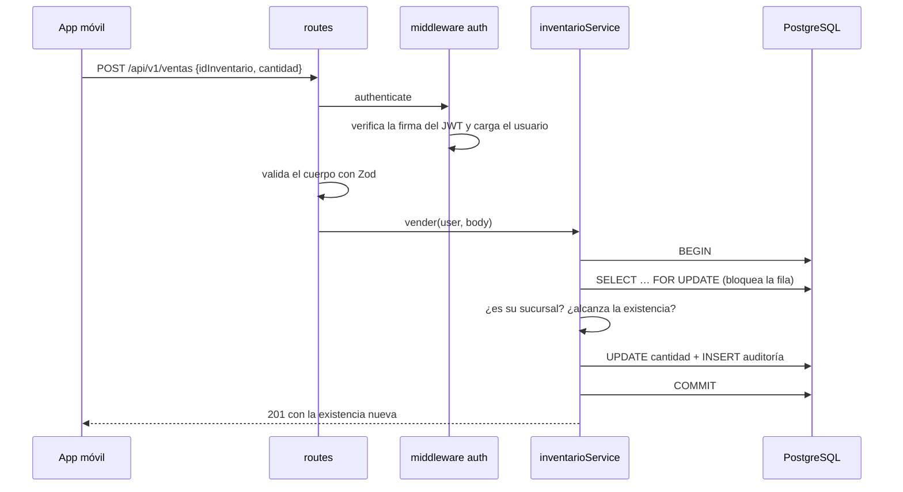
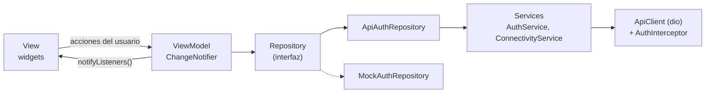
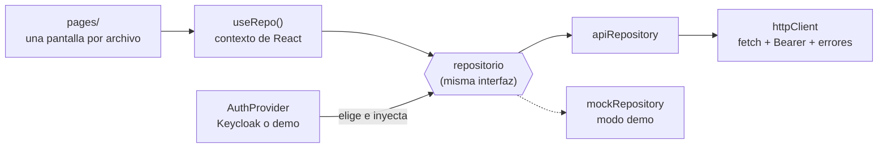
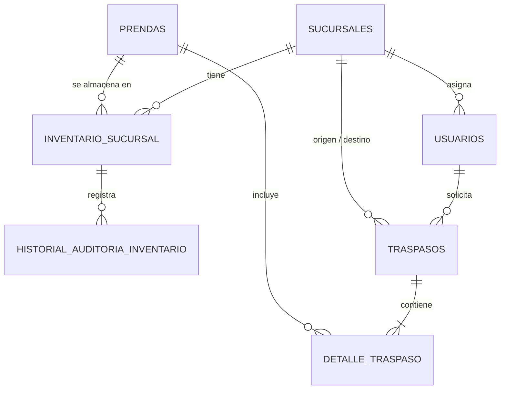
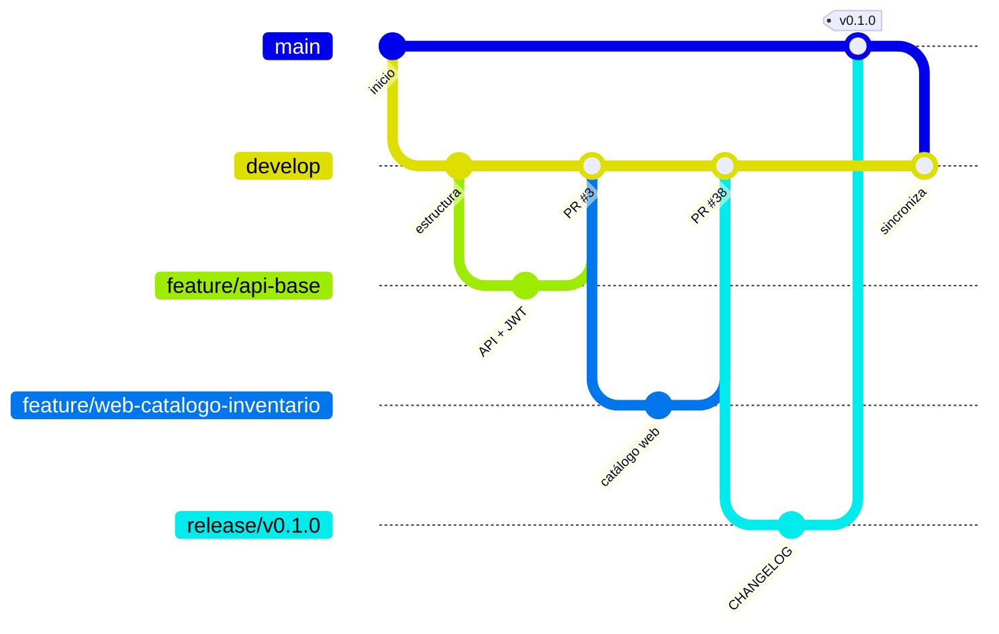
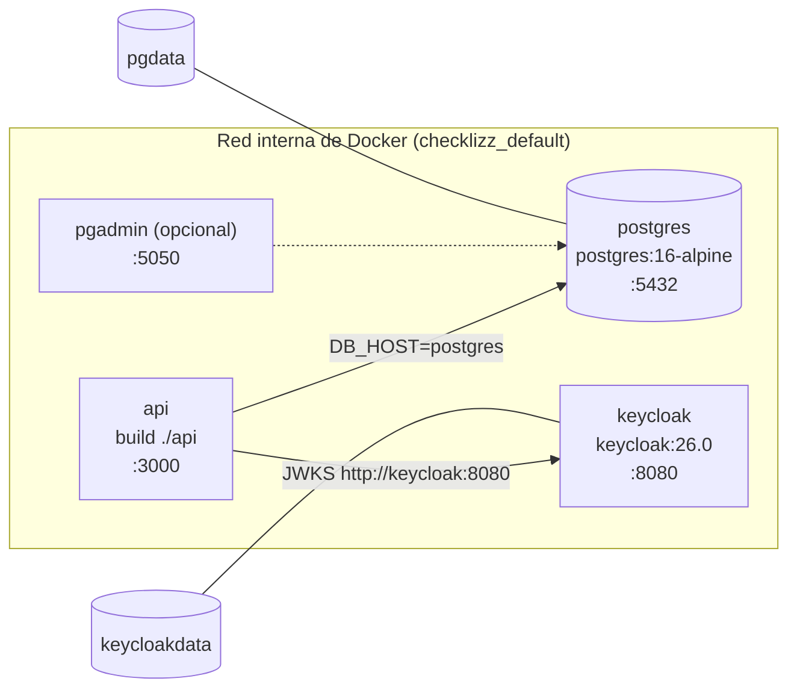

# Documento técnico · CheckLizz

**Sistema de inventario conectado y traspasos entre sucursales para Moda de Liz**

| | |
|---|---|
| Versión del documento | 1.0 (corresponde a la versión `v0.1.0` del sistema) |
| Fecha | 25 de noviembre de 2026 |
| Repositorio | https://github.com/RocioCastillo25/ModaDeLiz |
| Metodología | Scrum, 4 sprints de una semana (16 de noviembre al 10 de diciembre de 2026) |

## Contenido

1. [Introducción](#1-introducción)
2. [Arquitectura general](#2-arquitectura-general)
3. [Arquitectura de cada componente](#3-arquitectura-de-cada-componente)
4. [Seguridad y roles](#4-seguridad-y-roles)
5. [Modelo de datos](#5-modelo-de-datos)
6. [Principios SOLID](#6-principios-solid)
7. [Patrones de diseño](#7-patrones-de-diseño)
8. [Control de versiones: GitFlow](#8-control-de-versiones-gitflow)
9. [Contenedores: Docker](#9-contenedores-docker)
10. [Decisiones técnicas y limitaciones conocidas](#10-decisiones-técnicas-y-limitaciones-conocidas)
11. [Referencias](#11-referencias)

---

## 1. Introducción

### 1.1 Problema

Moda de Liz tiene 5 sucursales en la Sierra Norte de Puebla: Huauchinango (matriz), Zacatlán, Chignahuapan, Ahuazotepec y Xicotepec. El inventario se llevaba en papel o de memoria, y para saber si una prenda existía en otra tienda el personal preguntaba por WhatsApp con el cliente enfrente. Los traspasos entre tiendas se acordaban de palabra, sin registro.

### 1.2 Solución

CheckLizz centraliza el inventario de las 5 sucursales en una sola base de datos y lo expone a través de una API REST que consumen dos clientes:

- **App móvil** para empleados y gerentes: consultar existencias, escanear etiquetas, descontar piezas al vender y solicitar traspasos.
- **Página web** para la administradora y los gerentes: catálogo, alta y edición de prendas, carga inicial de inventario y reportes.

### 1.3 Alcance excluido

Control de asistencia, geolocalización, precios y cobros, integración con punto de venta, modo sin conexión y tienda en línea.

---

## 2. Arquitectura general

El sistema sigue una arquitectura **cliente-servidor en tres niveles**: presentación (app y web), lógica de negocio (API) y datos (PostgreSQL). La identidad se delega a **Keycloak**.



**Reglas de la arquitectura:**

- Los clientes **nunca** se conectan a la base de datos: todo pasa por la API.
- Las **reglas de negocio viven en la API** (existencia no negativa, permisos por sucursal, estados de traspaso). Los clientes validan lo mínimo para dar una buena experiencia, pero la API es quien decide.
- Ocultar un botón en la app o en la web **no** protege una operación: la API verifica el rol en cada petición.

### 2.1 Tecnologías

| Componente | Tecnología | Responsable |
|---|---|---|
| App móvil | Flutter 3, Dart, `get_it`, `dio`, `flutter_secure_storage` | Integrante 3 (MonicaItzel25) |
| API | Node.js 22, Express 4, `pg`, `zod`, `jose`, `pdfkit`, `exceljs` | Integrante 1 (kar5788-S) |
| Base de datos | PostgreSQL 16 | Integrante 1 (kar5788-S) |
| Identidad | Keycloak 26 (OpenID Connect, JWT) | Integrante 2 (Less-Riv) |
| Infraestructura | Docker Compose | Integrante 2 (Less-Riv) |
| Página web | React 19, Vite 6, React Router 7, `keycloak-js` | Integrante 4 (RocioCastillo25) |
| Repositorio y proceso | GitHub, GitFlow, GitHub Projects | Integrante 4 (RocioCastillo25) |

### 2.2 Estructura del repositorio

```
ModaDeLiz/
├── api/                # API REST (Node.js + Express)
├── mobile/             # App Flutter
├── web/                # Página web (React + Vite)
├── infra/
│   ├── postgres/init/  # 01_schema.sql y 02_seed.sql
│   └── keycloak/       # realm-checklizz.json (roles, cliente y usuarios de prueba)
├── docs/               # openapi.yaml, modelo relacional, bitácora y este documento
├── docker-compose.yml
└── .env.example
```

---

## 3. Arquitectura de cada componente

### 3.1 API REST: arquitectura en capas

La API separa responsabilidades en capas. Cada capa solo conoce a la de abajo.



| Capa | Carpeta | Responsabilidad | Ejemplo |
|---|---|---|---|
| Presentación | `routes/` | Recibir la petición, validar el cuerpo con Zod y responder | `POST /ventas` valida que `cantidad` sea entero positivo |
| Seguridad | `middlewares/` | Validar el token y el rol; traducir errores a JSON | `requireRole('administrador', 'gerente')` |
| Negocio | `services/` | Aplicar reglas y coordinar transacciones | `inventarioService.vender` bloquea la fila y verifica existencia |
| Dominio | `domain/` | Reglas puras, fáciles de probar | `traspasos.transicionValida('SOLICITADO', 'APROBADO')` |
| Datos | `repositories/` | SQL parametrizado; nada de reglas | `inventarioRepository.lockById` (`SELECT … FOR UPDATE`) |

**Ejemplo de una petición completa:** un empleado vende una pieza.



El bloqueo `FOR UPDATE` evita que dos empleados vendan la última pieza al mismo tiempo y la existencia quede negativa. La base de datos también lo impide con `CHECK (cantidad >= 0)`, como segunda defensa.

### 3.2 App móvil: MVVM



| Capa | Carpeta | Regla |
|---|---|---|
| View | `features/*/…_view.dart` | Solo muestra estado y envía acciones; nunca llama a la API |
| ViewModel | `features/*/…_view_model.dart` | Guarda el estado (cargando, datos, error); no importa `material.dart` |
| Model / DTO | `data/models`, `data/dto` | Datos con su constructor `fromJson` |
| Repository | `data/repositories` | Único acceso a datos para los ViewModels; implementación real y simulada |
| Service | `data/services`, `core/` | Cliente HTTP, almacenamiento seguro del token, conectividad |

Todas las dependencias se ensamblan en un solo lugar: `core/di/service_locator.dart`.

### 3.3 Página web: capas con inyección por contexto



| Módulo | Responsabilidad |
|---|---|
| `auth/AuthProvider.jsx` | Inicia sesión con Keycloak (PKCE), obtiene el perfil y decide qué repositorio usa toda la app |
| `api/httpClient.js` | Envuelve `fetch`, agrega el token y traduce errores HTTP a mensajes para el usuario |
| `repositories/` | `apiRepository` (real) y `mockRepository` (datos en memoria), intercambiables con `VITE_USE_MOCK` |
| `pages/*.js` | Lógica sin interfaz (validación, carga CSV), probada aparte |
| `pages/*.jsx` | Pantallas: catálogo, ficha, existencias, formulario de prenda y carga inicial |

---

## 4. Seguridad y roles

### 4.1 Autenticación

1. El usuario inicia sesión en **Keycloak** y recibe un **token JWT** firmado.
   - App móvil: usuario y contraseña (*password grant*).
   - Web: flujo de código de autorización con **PKCE**; la contraseña nunca pasa por la página.
2. Cada petición a la API lleva `Authorization: Bearer <token>`.
3. La API verifica la **firma** del token con las llaves públicas de Keycloak (JWKS), el **emisor** y la **vigencia** (`middlewares/auth.js`).
4. Con el `sub` del token, la API busca al usuario en su tabla `usuarios`. Si no existe o está **desactivado**, responde 403 aunque el token sea válido.

### 4.2 Roles

| Rol (Keycloak) | Quién | Plataforma | Alcance |
|---|---|---|---|
| `administrador` | La dueña | Web | Todas las sucursales; usuarios, reportes y cualquier traspaso |
| `gerente` | Uno por sucursal | Web y móvil | Solo su sucursal: inventario, carga y aprobación de traspasos |
| `empleado` | 25+ personas | Móvil | Consulta las 5 sucursales; descuenta y solicita solo en la suya |

La sucursal de cada operación se toma del **usuario autenticado**, nunca de un campo que el cliente pueda editar.

### 4.3 Otras medidas

- El token se guarda en almacenamiento seguro del dispositivo (`flutter_secure_storage`); nunca se guarda la contraseña.
- Las consultas SQL son **parametrizadas** (`$1, $2…`), lo que evita inyección SQL.
- Los mensajes de error no revelan detalles internos; los errores inesperados responden un genérico `ERROR_INTERNO`.
- Los secretos viven en `.env`, que está en `.gitignore`; al repositorio solo sube `.env.example`.
- El contenedor de la API corre con el usuario sin privilegios `node`.

---

## 5. Modelo de datos

El detalle completo está en [`modelo-relacional.md`](modelo-relacional.md) y en `infra/postgres/init/01_schema.sql`.



**Decisiones clave:**

- El inventario se lleva por **prenda + sucursal + talla + color** (`UNIQUE` sobre las cuatro columnas).
- `CHECK (cantidad >= 0)`: la base de datos rechaza cualquier existencia negativa, aunque falle la validación de la API.
- Cada cambio de existencia (alta, venta, traspaso o ajuste) deja un registro en `historial_auditoria_inventario` con la cantidad anterior, la nueva, el usuario y la fecha.
- Las prendas no se borran: se **desactivan** (`activa = false`) para conservar su historial.

---

## 6. Principios SOLID

### S · Responsabilidad única

> Cada módulo tiene una sola razón para cambiar.

| Ejemplo | Única responsabilidad |
|---|---|
| `api/src/repositories/prendasRepository.js` | Solo SQL de prendas. Si cambia la tabla, cambia solo este archivo |
| `api/src/services/prendasService.js` | Solo reglas: por ejemplo, rechaza un código de barras duplicado con `409 CODIGO_DUPLICADO` |
| `api/src/exportadores/pdf.js` y `xlsx.js` | Solo convertir un reporte ya armado a un formato de archivo |
| `web/src/pages/tablaCarga.js` | Solo leer CSV y convertirlo a filas; no sabe nada de pantallas ni de la API |
| `mobile/lib/features/auth/login_view_model.dart` | Solo el estado del inicio de sesión; no dibuja nada |

### O · Abierto/cerrado

> Se puede extender sin modificar lo que ya funciona.

- **Reportes:** `domain/reportes.js` arma un documento neutral (título, columnas y filas) y cada exportador lo convierte a su formato. Para agregar CSV se escribe `exportadores/csv.js` sin tocar los reportes existentes.
- **Rutas con roles:** `requireRole(...permitidos)` se reutiliza en cada ruta. Proteger una ruta nueva es agregar el middleware, sin modificar `auth.js`.

### L · Sustitución de Liskov

> Una implementación puede reemplazar a otra sin que quien la usa lo note.

- **App móvil:** `ApiAuthRepository` y `MockAuthRepository` implementan `AuthRepository`. Los ViewModels funcionan igual con cualquiera de las dos; se intercambian con `useMock` en `service_locator.dart`.
- **Web:** `apiRepository` y `mockRepository` exponen exactamente los mismos métodos (`buscarPrendas`, `fijarExistencia`…) y devuelven los mismos errores (`ApiError` con 403, 404 o 409). Las pantallas no saben cuál están usando.

### I · Segregación de interfaces

> Ninguna clase depende de métodos que no usa.

En la app móvil, cada capacidad es una interfaz pequeña:

- `TokenStorage`: `save`, `read` y `clear`.
- `ConnectivityService`: solo `isOnline`.
- `AuthRepository`: `login`, `restoreSession` y `logout`.

`LoginViewModel` depende solo de las tres que necesita, y en las pruebas cada una se sustituye por una versión falsa de pocas líneas.

### D · Inversión de dependencias

> Los módulos de alto nivel dependen de abstracciones, no de implementaciones concretas.

- **App móvil:** los ViewModels reciben sus dependencias por constructor y `service_locator.dart` es el único lugar que decide las implementaciones concretas (`SecureTokenStorage`, `ConnectivityPlusService`…).
- **Web:** las páginas piden el repositorio con `useRepo()` y nunca importan `fetch` ni `apiRepository`; `AuthProvider` decide cuál inyectar.
- **API:** la configuración llega de variables de entorno (`config/env.js`), no está escrita en el código; el mismo contenedor corre en cualquier máquina.

---

## 7. Patrones de diseño

Se aplicaron solo donde resuelven un problema concreto.

| Patrón | Dónde | Problema que resuelve |
|---|---|---|
| **Singleton** | `api/src/db/pool.js` (un solo pool de conexiones); `ApiClient` registrado como *lazy singleton* en `get_it` | Evita abrir una conexión por petición y agotar PostgreSQL; un solo cliente HTTP configurado en la app |
| **Repository** | `api/src/repositories/`, `mobile/lib/data/repositories/`, `web/src/repositories/` | Oculta de dónde vienen los datos; permite cambiar la API real por datos simulados |
| **Decorator** | `mobile/.../auth_interceptor.dart` (interceptor de `dio`); `web/src/api/httpClient.js` (envuelve `fetch`) | Agrega el token `Bearer` y el manejo de 401/403 a todas las peticiones sin repetir código |
| **Factory** | Constructores `fromJson` en `mobile/lib/data/dto/` y `data/models/` | Centraliza cómo se construye cada objeto a partir del JSON de la API |
| **Adapter** | DTO → modelo en la app; `exportadores/pdf.js` y `xlsx.js` en la API | Traduce formatos externos (JSON de la API, librerías `pdfkit` y `exceljs`) al formato interno |
| **Strategy** | Exportadores de reportes (PDF o Excel); modos *Sumar* o *Reemplazar* en la carga de inventario (`web/src/pages/cargaInventario.js`) | Elige el algoritmo en tiempo de ejecución sin `if` repartidos por el código |
| **Observer** | ViewModels con `ChangeNotifier` (móvil); estado de React con `useState` (web) | La interfaz se actualiza sola cuando cambia el estado |
| **Middleware / Chain of Responsibility** | `authenticate → requireRole → ruta → errorHandler` en Express | Cada eslabón decide si deja pasar la petición, la rechaza o la transforma |
| **Unit of Work** | `withTransaction(fn)` en `api/src/db/pool.js` | Las operaciones de una venta o un traspaso se aplican todas o ninguna (`BEGIN`/`COMMIT`/`ROLLBACK`) |
| **Dependency Injection** | `get_it` (móvil); contexto de React (web) | Las clases no crean sus dependencias; facilita las pruebas y el modo simulado |

---

## 8. Control de versiones: GitFlow

### 8.1 Ramas



| Rama | Propósito | Se crea desde | Se fusiona en |
|---|---|---|---|
| `main` | Versiones entregadas a la dueña; cada fusión lleva una etiqueta `vX.Y.Z` | — | — |
| `develop` | Integración del trabajo terminado del sprint | `main` | `release/*` |
| `feature/*` | Una historia de usuario o tarea (`feature/web-carga-inventario`) | `develop` | `develop` |
| `fix/*` | Corrección de un error | `develop` | `develop` |
| `chore/*`, `docs/*` | Mantenimiento o documentación | `develop` | `develop` |
| `release/*` | Preparar una versión (CHANGELOG, número de versión) | `develop` | `main` y de regreso a `develop` |

### 8.2 Reglas de protección

`main` y `develop` están protegidas con *rulesets* de GitHub (`protect-main` y `protect-develop`):

- Solo se modifican mediante **Pull Request**.
- Se requiere **al menos 1 aprobación** de otra persona.
- Si se suben commits después de aprobar, **la aprobación se descarta** y hay que revisar de nuevo.
- No se permite **force push** ni **borrar** la rama.
- Nadie tiene permiso para saltarse las reglas, ni la administradora del repositorio.

### 8.3 Flujo de una tarea

1. Se crea una **issue** con la plantilla de historia de usuario y se agrega al tablero de **GitHub Projects** (*Backlog → Sprint → En progreso → En revisión → Hecho*).
2. Se crea la rama desde `develop` actualizada: `git checkout develop && git pull && git checkout -b feature/…`.
3. Se hacen commits pequeños con **Conventional Commits** en español.
4. Se abre un PR hacia `develop` con la plantilla del repositorio y `Closes #N` para cerrar la issue al fusionar.
5. Otra persona revisa y aprueba; se fusiona y la issue pasa a *Hecho*.

### 8.4 Convención de commits

```
<tipo>(<alcance>): <descripción en español, en imperativo>
```

| Tipo | Uso | Ejemplo real |
|---|---|---|
| `feat` | Funcionalidad nueva | `feat(web): carga inicial de inventario por CSV` |
| `fix` | Corrección | `fix(auth): evitar que Android ofrezca guardar la contraseña` |
| `docs` | Documentación | `docs(docs): actualizar la bitácora del Sprint 1` |
| `chore` | Mantenimiento | `chore: reestructurar repositorio y agregar plantillas base` |

### 8.5 Versiones

Se usa **versionado semántico** (`MAYOR.MENOR.PARCHE`). Mientras el sistema está en construcción, la versión mayor es `0`, y cada entrega a la dueña sube la versión menor (`v0.1.0`, `v0.2.0`…). Los cambios de cada versión se registran en `CHANGELOG.md` y en la *release* de GitHub.

---

## 9. Contenedores: Docker

### 9.1 Servicios

Todo el backend se levanta con un solo comando definido en `docker-compose.yml`:



| Servicio | Imagen | Puerto en la PC | Detalle |
|---|---|---|---|
| `postgres` | `postgres:16-alpine` | `5432` (`POSTGRES_PORT`) | Ejecuta `infra/postgres/init/*.sql` la primera vez; *healthcheck* con `pg_isready` |
| `keycloak` | `quay.io/keycloak/keycloak:26.0` | `8080` (`KEYCLOAK_PORT`) | `start-dev --import-realm`: importa roles, cliente y usuarios de `realm-checklizz.json` |
| `api` | Se construye con `api/Dockerfile` | `3000` (`API_PORT`) | Arranca hasta que PostgreSQL está sano (`depends_on: service_healthy`) |
| `pgadmin` | `dpage/pgadmin4` | `5050` | Solo con `--profile tools` |

Los servicios se encuentran entre sí **por nombre** (`postgres`, `keycloak`) dentro de la red de Docker; desde la PC se usan los puertos publicados en `localhost`.

### 9.2 Imagen de la API

```dockerfile
FROM node:22-alpine
WORKDIR /app
COPY package*.json ./          # primero las dependencias: aprovecha la caché
RUN npm install --omit=dev     # sin dependencias de desarrollo
COPY src ./src
ENV NODE_ENV=production
EXPOSE 3000
USER node                      # sin privilegios de root
CMD ["node", "src/server.js"]
```

### 9.3 Cómo levantar el sistema

```bash
cp .env.example .env               # ajustar puertos o contraseñas si hace falta
docker compose up -d --build       # PostgreSQL + Keycloak + API
docker compose --profile tools up -d   # (opcional) agrega pgAdmin
docker compose ps                  # ver el estado de los servicios
curl http://localhost:3000/health  # {"status":"ok","db":"ok",...}
```

Web y app se ejecutan fuera de Docker durante el desarrollo:

```bash
cd web && npm install && npm run dev     # http://localhost:5173
cd mobile && flutter run                 # emulador o teléfono
```

### 9.4 Persistencia y problemas comunes

- Los datos sobreviven a `docker compose down` gracias a los **volúmenes** `pgdata` y `keycloakdata`.
- `docker compose down -v` **borra** los volúmenes; los scripts de `init/` vuelven a correr en el siguiente arranque.
- *"port is already allocated"*: otro programa usa ese puerto. Se cambia solo el de la PC en `.env` (por ejemplo, `POSTGRES_PORT=5433`).
- Teléfono físico: hay que agregar la IP de la PC a `ALLOWED_ISSUERS`, porque el emisor del token cambia según la dirección con la que se pidió.

---

## 10. Decisiones técnicas y limitaciones conocidas

| Tema | Decisión o limitación | Siguiente paso propuesto |
|---|---|---|
| Datos simulados | App y web tienen un repositorio simulado para avanzar y hacer demostraciones sin la API | Se mantiene para pruebas y presentaciones |
| Suma en la carga inicial | La API solo ofrece `PUT /inventario`, que **fija** la cantidad. Para sumar, la web lee la existencia y envía el total; no es atómico y una venta simultánea podría perderse | Agregar `POST /inventario/entradas` que sume con `FOR UPDATE`, como `/ventas` |
| Foto de prenda | La edición usa `COALESCE`, así que una foto guardada se puede reemplazar pero no borrar | Permitir `null` explícito en `PUT /prendas/{id}` |
| Búsqueda | `GET /prendas` devuelve como máximo 100 resultados, sin paginación | Agregar `limit` y `offset` |
| Web en Docker | La web todavía no tiene servicio en `docker-compose.yml` | Agregar un contenedor con `nginx` que sirva `web/dist` |
| Login móvil | Usa *password grant*, más simple pero menos recomendado que PKCE | Migrar a `flutter_appauth` con PKCE |

---

## 11. Referencias

- Contrato de la API: [`docs/openapi.yaml`](openapi.yaml)
- Modelo relacional: [`docs/modelo-relacional.md`](modelo-relacional.md)
- Contexto del proyecto: [`docs/project-context.md`](project-context.md)
- Reglas técnicas: [`docs/reglas.md`](reglas.md)
- Bitácoras: [`docs/sprint-1.md`](sprint-1.md) a [`docs/sprint-4.md`](sprint-4.md)
- Tablero: GitHub Projects, *CheckLizz · Sprint 1*
