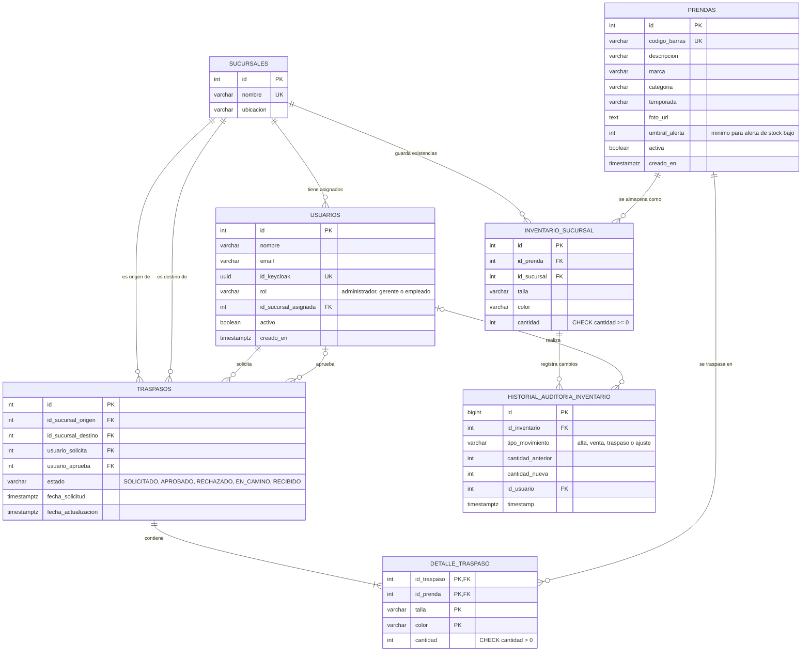

# CheckLizz · Modelo relacional

Diagrama Entidad-Relación de la base de datos PostgreSQL (7 tablas). Se genera a partir de `infra/postgres/init/01_schema.sql`. GitHub lo muestra como dibujo; si no, se puede pegar el bloque en https://mermaid.live

## Reglas que garantiza la base de datos
- `inventario_sucursal.cantidad >= 0`: el stock nunca queda negativo.
- `UNIQUE (id_prenda, id_sucursal, talla, color)`: una sola fila por prenda, talla y color en cada sucursal.
- `traspasos`: origen y destino deben ser distintos; el estado solo admite los 5 valores definidos.
- `usuarios`: gerente y empleado siempre tienen sucursal; solo el administrador puede no tenerla.
- `historial_auditoria_inventario`: cada venta, alta, traspaso o ajuste deja el valor anterior y el nuevo, quién lo hizo y cuándo.
